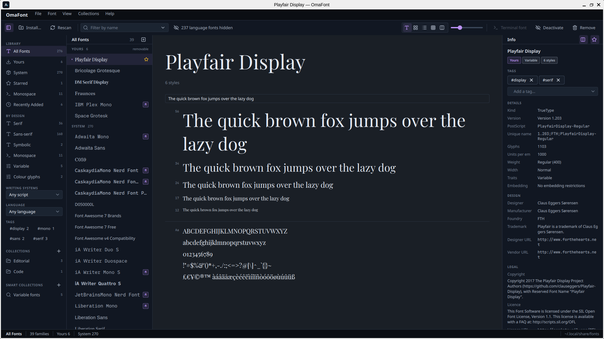
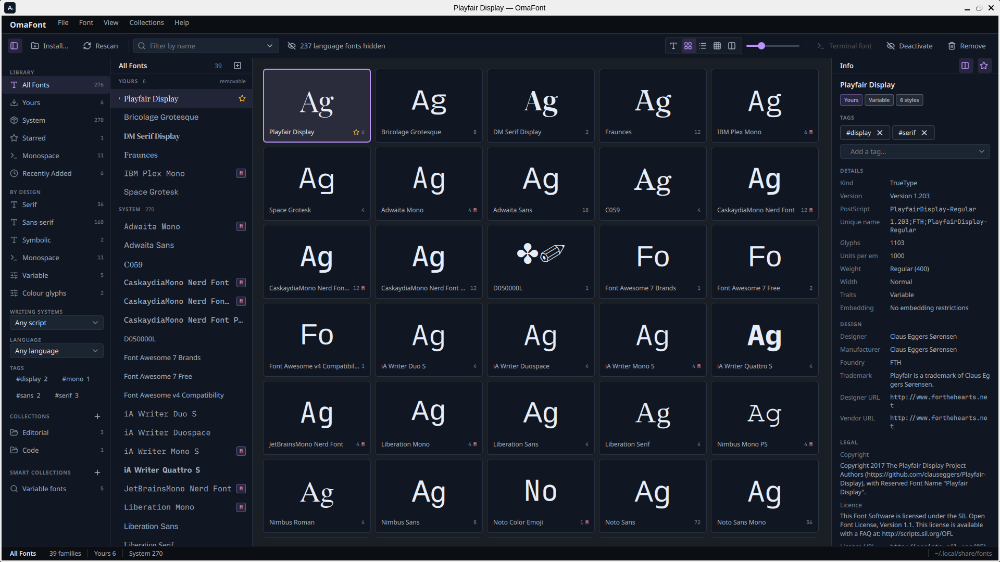
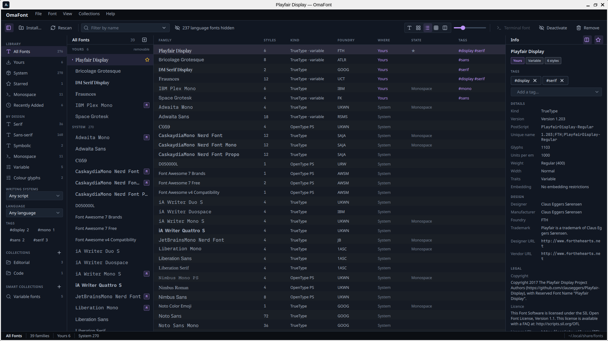
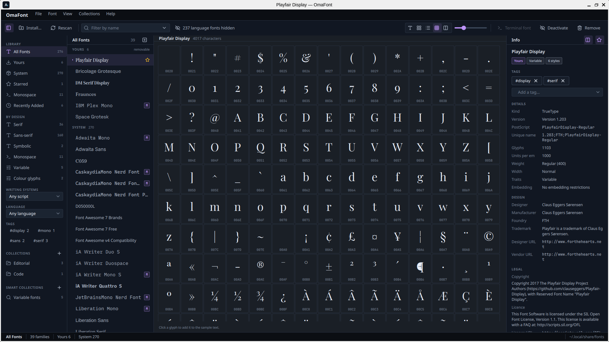
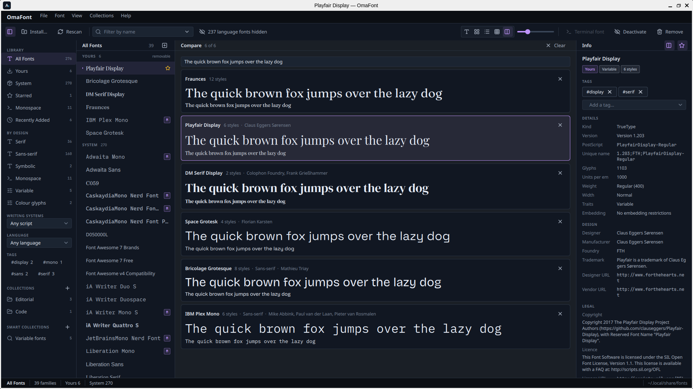
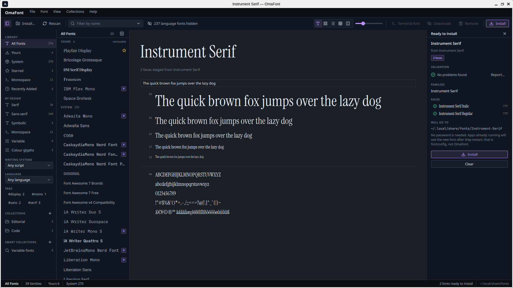

# OmaFont

A font manager for Omarchy. See what is installed, preview any family in its
own typeface, read what the files say about themselves, install a whole pack
in one go, deactivate what you do not want without deleting it, group fonts
into collections, and hand a monospace family to the terminal. Part of the
Oma creative suite.



## Install

OmaFont is made for Omarchy.

Download the package from the [latest release](https://github.com/28allday/omafont-app/releases/latest),
then open a terminal with **Super + Enter** and install it:

```sh
sudo pacman -U ~/Downloads/omafont-0.1.1-1-x86_64.pkg.tar.zst
```

Or download and install it from the terminal in one go:

```sh
curl -LO https://github.com/28allday/omafont-app/releases/download/v0.1.1/omafont-0.1.1-1-x86_64.pkg.tar.zst
sudo pacman -U ./omafont-0.1.1-1-x86_64.pkg.tar.zst
```

Type your password when asked, and press Enter to confirm. Then open OmaFont
from the app launcher: press **Super + Space** and type **OmaFont**. Font
files also open in it from your file manager.

(The package is unsigned, so pacman won't install it straight from a URL —
download it first and install the local file. `SHA256SUMS` on the release page
lets you check the download.)

### Building it yourself

On ARM (aarch64), or if you would rather build from source:

```sh
sudo pacman -S --needed base-devel git
git clone https://github.com/28allday/omafont-app.git ~/omafont-app
cd ~/omafont-app
./bin/install
```

It builds on your computer in a minute or two and installs the same package.

### Updating

Install the newer package from the [latest release](https://github.com/28allday/omafont-app/releases/latest)
the same way; pacman replaces the old one. If you built it yourself:

```sh
cd ~/omafont-app
git pull
./bin/install
```

Close and reopen OmaFont after updating. `omafont --version` says which
version you have.

### Uninstalling

```sh
sudo pacman -R omafont
```

That removes the app. Fonts you installed with it stay where they are, in
`~/.local/share/fonts`. To also forget your collections, tags and notes, and
switch every deactivated font back on, delete these:

```sh
rm -rf ~/.config/omafont
rm -f ~/.config/fontconfig/conf.d/60-omafont-deactivated.conf
```

## The window

**Sidebar** — where the families come from. All Fonts, Yours, System,
Starred, Monospace, Recently Added, Deactivated, Duplicates; then **By
design** (Serif, Sans-serif, Handwriting, Ornamental, Symbolic, Monospace,
Variable, Colour glyphs, worked out from the files themselves); a writing
system picker (Latin, Greek, Cyrillic, Arabic, Devanagari…); a language
picker; your tags; and your collections and smart collections. `Ctrl+B` hides
it.

**The list** shows the families of the chosen source, split into **Yours**,
the ones in your font folder that you can remove, and **System**, which belong
to packages. Starred families float to the top. Each family is set in its own
typeface. An `M` marks a monospace family, a star a starred one, a crossed eye
a deactivated one, a double square one with duplicate faces. **View ▸ Sort
by** orders them by name, date added, number of styles or foundry.

**Families, not weights.** Older font packs name every weight as its own
family, so a plain font list shows Acme Sans, Acme Sans Black, Acme Sans Bold,
Acme Sans Book and more as separate entries. OmaFont folds them into one
family, Acme Sans, with Black, Bold and Book among its styles. The Info pane says which names
were folded in. Turn it off under **View ▸ Group weights into one family** if
you prefer the raw names.

**Language fonts are hidden by default.** A typical Arch install carries around
300 Noto families, one per writing system, which buries the forty or so fonts
you would ever deliberately choose. They stay installed; they are just folded
out of the way. The toolbar says how many are hidden and unfolds them, and
typing a filter searches all of them regardless. Your own fonts never fold.

**The view** in the middle has five modes, in the toolbar or `Ctrl+1` to `5`:

| View | Shows |
|---|---|
| Specimen | The name at display size, the sample line at five sizes, the character set |
| Grid | Every family as a card with a big "Ag" in its own face |
| List | A table: family, styles, kind, foundry, where it lives, its state |
| Repertoire | Every character the face covers, with code points. Click one to add it to the sample |
| Compare | Up to six families stacked, the same sample line in each. `Ctrl+M` adds or removes the selected family |

The sample line is editable, because a font is chosen against the words it
will actually set. The slider, or `Ctrl` `+` and `−`, changes the type size.









**The Info pane** on the right starts with your own marks: a star, tags, and a
note. Then it reads the font files themselves: kind, version, PostScript and
unique names, glyph count, units per em, weight, width, traits, embedding
permissions, design class, designer, manufacturer, foundry, trademark,
copyright, licence, description, the languages and writing systems it covers.
Then the styles, each in its own face with its own deactivate switch; the
files on disk, with when and from what they were installed; the collections
it belongs to; and the actions.

## Tags, stars and notes

A **tag** is an adjective: `display`, `body`, `code`, a client, a licence.
Type it into the Info pane; existing tags autocomplete. Tags appear in the
sidebar with counts, click one to filter, and `#display` in the search box
finds them too. Right-click a tag in the sidebar to rename it everywhere or
remove it. A **star** (`Ctrl+S`) floats a family to the top of every list and
gives it a sidebar source of its own. A **note** is free text per family: why
you have it, where it is licensed, what it is for.

## Search

The filter box searches names by default: family, style, PostScript and full
names. The chevron picks another scope:

- **Designer or foundry** — who made it, from the file's own name table.
- **Supports these characters** — type the characters a font must have, for
  instance `ẞ` or `→`, and only families that cover them are listed.
  fontconfig answers this one, so it is exact.

## Installing fonts



| How | What happens |
|---|---|
| Drop a file, folder or archive on the window | Everything installable inside it is staged |
| **Install…** in the toolbar, or `Ctrl+O` | Same, through the desktop file chooser |
| Open a font file from your file manager | Opens OmaFont with that font staged |
| `omafont ~/Downloads/Pack.zip` | Same, from a terminal |

Staged fonts are **validated and previewed before anything is written**. The
Info pane lists every family and face it is about to install, marks the ones
with problems, and says where they will go. A face with serious problems is
left out unless you tick "install anyway"; minor findings are reported and
installed. **Report…** shows the full validation report.

If a file is already in place you choose what happens: **Replace** it, **Skip**
it, or **Keep both** (the new copy gets a `-2` suffix).

A downloaded family is rarely one file, so a folder or an archive installs
whole. Zips, tarballs and 7z all work. Packs often ship the same faces as both
OTF and TTF; when that happens you get a choice, because the two formats
frequently disagree about family names and cannot be merged reliably.

Fonts land in `~/.local/share/fonts/<Family>/` (or under `$XDG_DATA_HOME` if
you have set it). No password is needed.

**Applications already running will not see a new font until they restart.**
That is fontconfig, not OmaFont. Apps opened afterwards pick it up straight
away. Some apps, such as DaVinci Resolve, read the font list only when they
start, so quit and reopen them after installing.

## Deactivating fonts

**Deactivate** (`Ctrl+D`) hides a family from every application without
touching its files. System fonts included: a package's font can be switched
off for your account and switched back on later. The crossed-eye button on a
single style deactivates just that face, which is how you resolve a duplicate.
Deactivated fonts stay in the list, struck through, and under **Deactivated**
in the sidebar. **Activate** brings them back.

Behind it is one fontconfig file, `~/.config/fontconfig/conf.d/60-omafont-deactivated.conf`,
which OmaFont writes and removes. Nothing else is changed.

## Duplicates

The same family and style in two files is a duplicate: one copy wins at render
time and nobody chose which. **Duplicates** in the sidebar lists the families
affected, the Info pane marks the faces, and deactivating or removing one copy
resolves it.

## Collections

A **collection** is a set of families you pick by hand: use the **Collections**
section of the Info pane, or **Font ▸ Add to collection**. A collection can be
**activated or deactivated as a whole**, so a project's fonts can be the only
ones switched on while you work, and **exported** to a folder, one subfolder
per family, to hand to a client. Right-click it in the sidebar.

A **smart collection** is a set of rules: family name, style, PostScript name,
designer, manufacturer, kind, language, writing system, design class, trait,
tag, location or weight, each with *contains*, *begins with*, *ends with*,
*is* or *is not*, matching all or any. Right-click one in the sidebar to edit,
rename or delete it.

## Tidy up

**File ▸ Tidy up** (`Ctrl+Shift+T`) lists what is worth cleaning, each with a
fix: the same styles installed as both OTF and TTF (keep one format), static
weights sitting beside a variable font (keep the variable font), files that
fail validation, fonts of yours that set no Latin text, and how much the
language-coverage families take up. Package copies are only ever deactivated.
Anything that would delete your own files asks first and lists them.

## Removing, exporting, validating

- **Remove** (`Delete`) asks first, then deletes a family's files from your
  own font folder and prunes the empty folder. System fonts cannot be removed from here; deactivate
  them instead.
- **Export** (`Ctrl+E`) copies a family's files to a folder you choose.
- **Validate** (`Ctrl+Shift+V`) checks every file of a family: the table
  directory, required tables, glyph count, names, the character map, the
  embedding flags, and whether the font engine can load it.
- **Show in file manager** opens the folder the files live in.
- **Save as PDF** writes a family's specimen, waterfall or repertoire, ready
  to print.

## Setting your terminal font

Select a monospace family and click **Terminal font** or press `Ctrl+T`. This
hands off to Omarchy's own `omarchy-font-set`, so your terminal configs and
the monospace alias are updated the way Omarchy expects. The button only
appears on a machine that has that tool.

## Keyboard

| Key | Does |
|---|---|
| `Ctrl+O` | Install fonts from a file, folder or archive |
| `Enter` | Install what is staged |
| `Esc` | Clear the stage, then the filter |
| `/` | Filter the families |
| `↑` `↓` `Home` `End` `PgUp` `PgDn` | Move through the list |
| `Delete` | Remove the selected family (yours only) |
| `Ctrl+S` | Star or unstar the selected family |
| `Ctrl+M` | Add the selected family to Compare, or take it out |
| `Ctrl+D` | Deactivate or activate the selected family |
| `Ctrl+E` | Export the selected family's files |
| `Ctrl+Shift+V` | Validate the selected family |
| `Ctrl+P` | Save a specimen PDF |
| `Ctrl+T` | Set the selected monospace family as the terminal font |
| `Ctrl+1` … `Ctrl+5` | Specimen, Grid, List, Repertoire, Compare |
| `Ctrl+Shift+T` | Tidy up |
| `Ctrl` `+` / `−` / `0` | Bigger, smaller, actual size |
| `Ctrl+B` | Show or hide the sidebar |
| `Ctrl+L` | Show or hide the language-coverage fonts |
| `Ctrl+R` | Rescan |
| `?` | Keyboard shortcuts |
| `Ctrl+Q` | Quit |

## Command line

The same engine, with no window:

```bash
omafont list                      # installed families, yours first (--all includes language fonts)
omafont info Inter                # styles, designer, licence, glyph count, files
omafont install ~/Downloads/Pack.zip
omafont remove "Playfair Display"
omafont validate ~/Downloads/Pack/*.ttf   # or a family name
omafont deactivate "Noto Sans Tamil"
omafont activate "Noto Sans Tamil"
omafont export Inter ~/Desktop/inter-files
```

Add `--json` to any of them for scripts. `validate` exits 1 when a file has
serious problems.

## Requirements

Qt 6 (base, declarative, svg), fontconfig, libarchive, and an XDG desktop
portal for the file choosers. All of these are on every Omarchy install.

## What OmaFont writes

| Where | What |
|---|---|
| `~/.local/share/fonts/<Family>/` | Fonts you install (or under `$XDG_DATA_HOME/fonts`) |
| `~/.config/omafont/library.json` | Your collections, smart collections, tags, stars and notes |
| `~/.config/omafont/omafont.conf` | Window settings: view, sort order, sample text |
| `~/.config/fontconfig/conf.d/60-omafont-deactivated.conf` | The deactivated fonts; removed when nothing is deactivated |

Nothing outside your home folder is touched, and no password is needed for
anything but installing the app itself.

## Licence

MIT. Icons are from [Lucide](https://lucide.dev), ISC.
